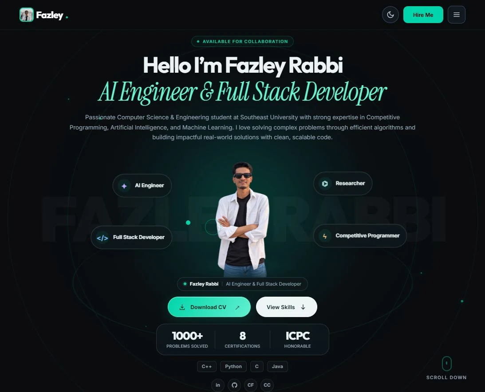

<div align="center">



# Hello, I’m Fazley Rabbi

**AI Engineer & Full Stack Developer**<br />
CSE at Southeast University · Competitive programmer · Research enthusiast

[**Explore my portfolio ↗**](https://rabbi1067.github.io/rabbi-portfolio/) · [LinkedIn](https://www.linkedin.com/in/fazleyrabbi1067) · [Email](mailto:fazlerabbicse65@gmail.com)

[](https://github.com/rabbi1067/rabbi-portfolio/actions/workflows/pages.yml)

**1,000+ problems solved** &nbsp; · &nbsp; **ICPC Asia Dhaka 2024 — Honorable Mention**

</div>

---

### A place for the work, and the thinking behind it

My portfolio brings together software projects, AI and machine learning exploration, competitive programming, research experience and credentials. A calm dark palette, teal accents and subtle portrait depth keep the focus on the work.

[](https://rabbi1067.github.io/rabbi-portfolio/)

### Explore

| Section | What you’ll find |
| :--- | :--- |
| [Selected Highlights](https://rabbi1067.github.io/rabbi-portfolio/#selected-highlights) | A curated, clickable gallery of projects, learning and achievements |
| [Projects](https://rabbi1067.github.io/rabbi-portfolio/#projects) | Selected work, technology tags and optional source/demo links |
| [Skills & Experience](https://rabbi1067.github.io/rabbi-portfolio/#skills) | Languages, tools, roles and practical experience |
| [Education](https://rabbi1067.github.io/rabbi-portfolio/#education) | Academic background with campus photos, qualifications and study periods |
| [Certifications & Awards](https://rabbi1067.github.io/rabbi-portfolio/#certifications) | Credentials with optional verification and certificate links |
| [Reviews](https://rabbi1067.github.io/rabbi-portfolio/#reviews) | Reviewer-approved feedback in a responsive carousel |
| [Contact](https://rabbi1067.github.io/rabbi-portfolio/#contact) | Social links, email and the contact form |

### Built with care

- **Responsive by design.** Layouts for phones, tablets and desktops; compact mobile skills and navigation.
- **Motion with restraint.** Pointer-driven portrait depth, floating role tags and reduced-motion support.
- **Smaller images.** Responsive WebP variants, lazy loading below the fold and original uploads preserved.
- **Content you can maintain.** Edit text, images, links, ordering and visibility through the CMS. Certificate counters follow published records automatically.
- **Automatic publishing.** Content changes become Git commits; GitHub Actions validates, builds and deploys the site.

### Frontend + Spring Boot backend

The repository now has two deployable parts:

| Folder | Purpose | Hosting |
| :--- | :--- | :--- |
| `frontend/` | Portfolio, modern footer, Administrator Studio, static fallback and media | Vercel, Render Static Site, or GitHub Pages |
| `backend/` | Java 21 / Spring Boot 4.1, email/password login, content CRUD, uploads and publishing | Render Docker with a persistent disk |

The backend can also serve the frontend itself. Every portfolio section is editable through Studio, including images, galleries, lists, ordering, visibility and publication links. Research cards support topics, journal/type badges, publication dates, DOI and paper/PDF links.

**[বাংলায় deployment ও editing guide](docs/DEPLOYMENT_BN.md)** · [Backend environment example](backend/.env.example) · [Frontend environment example](frontend/.env.example)

Administrator credentials belong **only on the backend**. The frontend receives the public `API_BASE_URL`. Backend edits live on its persistent disk; they do not automatically become Git commits. A backup export is available in Studio.

### Run the static site locally

```sh
python -m pip install -r frontend/requirements.txt
python frontend/scripts/build.py --source-prefix frontend
python -m http.server 8000 --bind 127.0.0.1 --directory frontend/dist
```

Open [localhost:8000](http://localhost:8000/). To connect the Spring Boot backend, follow the deployment guide. Without a backend URL, the public static portfolio still works, and the existing GitHub CMS remains available at `/admin/github/`.

### Validate

```sh
cd frontend
python -m unittest discover -s tests -v
cd ..
node --test auth/worker.test.mjs
mvn -f backend/pom.xml test
```

<details>
<summary><strong>For the owner — edit content & publish</strong></summary>

1. Open the [admin panel](https://rabbi1067.github.io/rabbi-portfolio/admin/) and choose **Use existing GitHub content manager**, then **Login with GitHub**.
2. Sign in with an authorized GitHub account that has repository write access.
3. Select **Portfolio settings**, **Projects**, **Research**, **Certifications** or **Reviews**; edit the record and choose **Publish**.
4. To hide an item, turn off **Published**. Use **Delete** to remove the record.
5. Wait for [Build and deploy portfolio](https://github.com/rabbi1067/rabbi-portfolio/actions/workflows/pages.yml) to finish, then refresh the website.

**বাংলায় ধাপে ধাপে:** [Portfolio edit করার গাইড](docs/ADMIN_GUIDE_BN.md)<br />
**Full configuration:** [Setup & troubleshooting](docs/SETUP.md)

The admin URL is public; editing requires authorization. Public repository content and uploaded files are public too. Keep credentials in the Worker’s encrypted secrets.

</details>

<details>
<summary><strong>Source map & further documentation</strong></summary>

```text
frontend/content/  Profile, skills and collection records
frontend/cms/      Editable field schema and non-secret settings
frontend/index.html Page layout template
frontend/css/ · js/ Styles, interactions and accessible navigation
frontend/scripts/  Static build and responsive image generation
frontend/admin/    Administrator Studio and optional GitHub CMS
auth/              OAuth Worker and its tests
frontend/tests/    Content, build and browser regression checks
backend/           Spring Boot API, Dockerfile and backend tests
docs/              Editing guide, setup notes and design documentation
```

[Design notes](docs/HOME_REDESIGN.md) · [Implementation](docs/IMPLEMENTATION.md) · [Changes](docs/CHANGES.md)

</details>

---

<div align="center">

**Let’s build something useful.**<br />
[Get in touch](https://rabbi1067.github.io/rabbi-portfolio/#contact) · [Codeforces](https://codeforces.com/profile/rabbi1067) · [CodeChef](https://www.codechef.com/users/rabbi1067)

<sub>Designed around clarity. Built to keep evolving.</sub>

</div>
